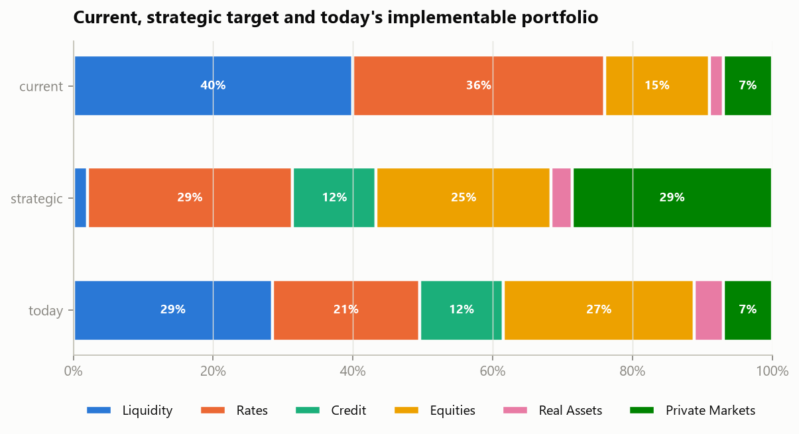
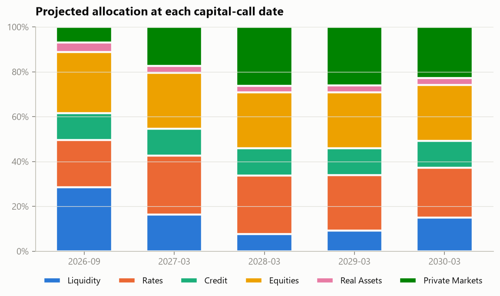
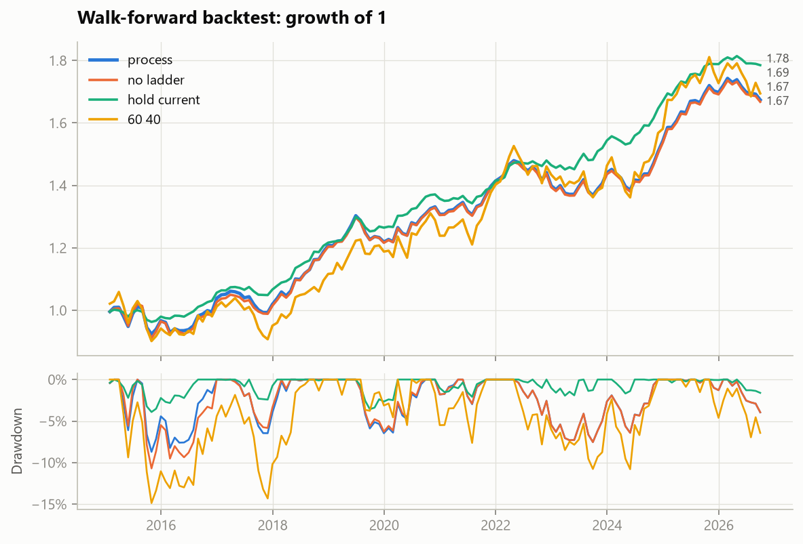
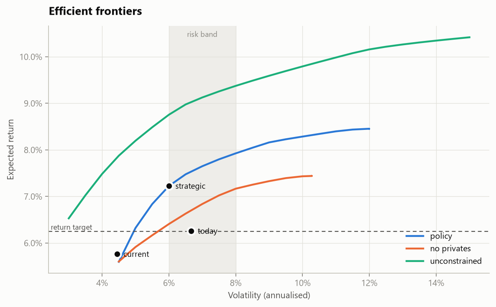
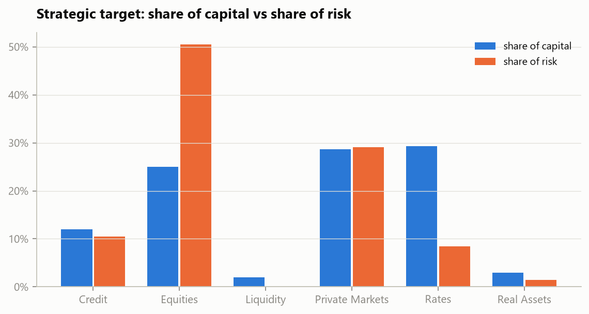
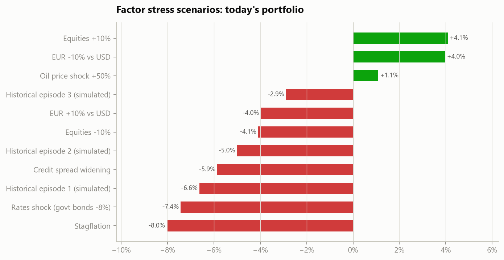
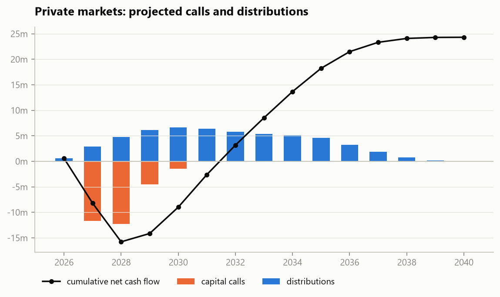
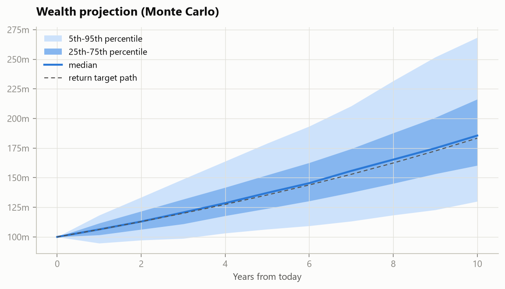

# saa-pm · Strategic Asset Allocation with Private Markets

[](https://github.com/Codes-Dennis-Jung/saa-pm/actions/workflows/ci.yml)


**A Python toolkit that builds a long-term investment portfolio around clear goals. It also handles
the part most optimisers ignore: private-market investments that cannot be traded and that call for
cash on their own schedule.**



> Every number and figure on this page comes from the **synthetic example mandate** in
> `examples/data`. The data is simulated, not real market prices, so you can reproduce every example yourself.

**Contents:**
[What it solves](#what-problem-does-it-solve) ·
[Quick start](#quick-start) ·
[Commands](#commands) ·
[Python](#using-it-from-python) ·
[Input files](#input-files--one-example-each) ·
[Outputs](#outputs) ·
[Analyses](#analyses--one-example-each) ·
[How it works](#how-it-works-in-brief) ·
[Structure](#project-structure)

---

## What problem does it solve?

A foundation, family office or pension fund typically has three goals, in this order:

1. **Earn enough**: e.g. inflation + 3% a year.
2. **Pay out enough**: e.g. at least 3% cash income a year.
3. **Stay within a comfortable risk range**: e.g. 6–9% volatility.

Adding **private equity, infrastructure and private debt** helps with goals 1 and 2, but these
investments come with strings attached:

- they **cannot be sold** at short notice;
- money is **committed now and called later**, on the fund manager's schedule;
- their reported values are **smoothed**, which makes them look safer than they are.

`saa-pm` answers the questions an investment committee asks:

| Question | What the toolkit produces |
|---|---|
| Where should the portfolio be in the long run? | **Strategic target**: meets the goals in priority order |
| What can we implement *today*? | **Today's portfolio**: private assets fixed at their current value, with enough cash, T-bills and bonds set aside for the capital calls already scheduled |
| How does the portfolio evolve as the calls come in? | **Transition plan** at every call date, including where each call is paid from |
| Would this process have worked in the past? | **Walk-forward backtest** using only information available at each date, against benchmarks |
| What could go wrong? | Risk attribution, stress tests, historical episodes, liquidity, income, sensitivity, private-markets cash flows (J-curve, IRR, TVPI), 10-year wealth projection |

**Example:** for the example mandate (USD 100m across 24 asset classes, goals of 6.25% return,
3.5% income and 6–8% volatility):

| portfolio | exp. return | income | volatility | illiquid |
|---|---:|---:|---:|---:|
| current | 5.76% | 3.49% | 4.44% | 7.0% |
| **strategic target** | 7.22% | 4.56% | 6.00% | 28.6% |
| **today (implementable)** | 6.26% | 3.50% | 6.67% | 7.0% |

The current book, 76% in cash and US Treasuries, misses the return goal and just misses the income
goal. The strategic target meets both at the lowest risk in the band. Today's portfolio already
meets both goals (6.26% return, 3.50% income) while setting aside 24.0% in cash for calls due within
two years. It cannot hold the strategic private
weight yet, because private funds can only be built up through commitments over time.

---

## Quick start

```bash
git clone https://github.com/Codes-Dennis-Jung/saa-pm.git
cd saa-pm
pip install -e ".[report]"             # Python 3.10+

saa-pm run examples/data -o results    # full study, about 2 minutes
```

**What to install:**

| Command | Gives you |
|---|---|
| `pip install -e .` | The calculation engine only (numpy, pandas, scipy, cvxpy). Ideal as a library. |
| `pip install -e ".[report]"` | Adds the charts (matplotlib) and the Excel workbook (openpyxl). |
| `pip install -e ".[notebooks]"` | Adds JupyterLab, to run the case-study notebooks in `examples/` (`jupyter lab examples`). |
| `pip install -e ".[dev]"` | Adds the tests, linting and type checking, for contributors. |

Without the `report` extra, a study still writes every CSV and `SUMMARY.md`, and simply notes that
the charts and the workbook were skipped.

**Example console output:**

```text
Loaded 24 assets, 189 months (2011-01 to 2026-09), portfolio 100,000,000
  allocation                      2.1s
  projection                      3.2s
  backtest                       57.1s
  analyses                        5.0s
  results written to ...\results
  write results                  12.6s
```

Then open `results/SUMMARY.md`, `results/saa_results.xlsx` or `results/charts/`.

---

## Commands

### `saa-pm check <folder>`: validate an input folder before running

```bash
saa-pm check examples/data
```

```text
            months  realised_return     cma  vol_reported  vol_desmoothed     phi
Gold           189           0.0438  0.0560        0.1350          0.1350  0.0000
Priv Infra     189           0.1036  0.1040        0.0631          0.0982  0.4142
Priv Eq        189           0.1047  0.1135        0.1629          0.2543  0.4126
Priv Debt      189           0.0785  0.0790        0.0413          0.0661  0.4309
WARNINGS
  ! current weight of 'Cash' 40.00% is outside [1.00%, 28.00%]
NOTES
  - 'US HY': income 7.25% > total return 6.35% (normal for credit, but confirm)
```

The output shows per-asset coverage, realised return against the assumption, and reported against
*desmoothed* volatility. Note that the smoothed private-equity series hides more than a third of
its real volatility. Warnings (here: today's book sits outside some of its own limits) do not stop
the run. Errors (for example a typo in an asset name, or bounds that cannot add up to
100%) stop the run with a clear message.

### `saa-pm run <folder> [-o out] [--steps ...] [--paths N]`: run the study

```bash
saa-pm run examples/data -o results                              # everything
saa-pm run examples/data -o quick --steps allocation projection  # only selected steps
saa-pm run examples/data --paths 2000                            # fewer Monte Carlo paths
```

The steps are `allocation`, `projection`, `backtest` and `analyses`.

### `saa-pm sample-data <folder> [--seed N]`: write a synthetic example folder to edit

```bash
saa-pm sample-data my_mandate
```

```text
sample input folder written to my_mandate
```

This is the fastest way to start with your own data: generate the folder, then replace the
numbers with your own.

---

## Using it from Python

**One call runs everything:**

```python
from saa_pm import SAAStudy

results = SAAStudy("examples/data", "results").run()
results.allocation.summary()       # current / strategic / today
results.backtest_metrics           # process vs benchmarks
results.tables.keys()              # every side-analysis table as a DataFrame
```

**Or use the building blocks:**

```python
from saa_pm import load_mandate, StateBuilder, GoalOptimizer

data  = load_mandate("examples/data")
state = StateBuilder(data).build()                   # inputs as of the last month
res   = GoalOptimizer(state.universe, state.sigma, state.optimizer).run()
print(res.solution.selection_rule)
```

```text
return+income met in band -> min risk
```

**No files needed: pass DataFrames directly.** In this example, `assets_df`, `prices_df` and the
other frames have the same columns as the CSV files described below:

```python
from saa_pm import MandateData, PointInTimeAllocator

data = MandateData.from_frames(
    assets=assets_df, prices=prices_df, holdings=holdings_df,       # required
    config={"cpi": 0.025, "return_spread": 0.03, "vol_hi": 0.09},   # plain dict
    groups=groups_df, pacing=pacing_df, commitment_future=calls_df,  # optional
)
PointInTimeAllocator(data).run().summary()
```

**Logging.** As a library, `saa_pm` is silent by default. Messages go to the standard `saa_pm`
logger:

```python
import logging
logging.basicConfig(level=logging.INFO)          # see progress messages
SAAStudy("examples/data", "results", verbose=False).run()
```

```text
INFO:saa_pm:Loaded 24 assets, 189 months (2011-01 to 2026-09), portfolio 100,000,000
INFO:saa_pm:  allocation                      2.1s
...
```

The package is fully type-annotated and ships `py.typed`, so editors and mypy check your code against it.

[`docs/EXAMPLES.md`](docs/EXAMPLES.md) has a worked example **with real output for every class and
method**: loading, validation, settings, universe, risk model, optimiser, what-ifs, funding ladder,
allocation, transition plan, stress variants, pacing model and backtest. A runnable script is in
[`examples/quickstart.py`](examples/quickstart.py).

### Case studies (Jupyter notebooks, executed)

Two notebooks solve the same investment-committee case end to end, step by step and with detailed
explanations. The case is a USD 100m mandate targeting CPI + 3%, 3.5% income by 2032 and 6–8%
volatility, starting from 45% cash.

| Notebook | Private-markets vehicle | Covers |
|---|---|---|
| [`Cases_study_SAA_ClosedEnd_PrivateMarkets.ipynb`](examples/Cases_study_SAA_ClosedEnd_PrivateMarkets.ipynb) | **closed-end funds** | client profile, data check, desmoothing, SAA, robustness, implementation, **commitment pacing plan**, J-curve and IRR, transition at each call date, **funding ladder**, liquidity stress, Monte Carlo |
| [`Cases_study_SAA_SemiLiquid_PrivateMarkets.ipynb`](examples/Cases_study_SAA_SemiLiquid_PrivateMarkets.ipynb) | **semi-liquid evergreen funds (ELTIF)** | the same case: subscription plan instead of pacing, **no funding ladder**, gate run-off, denominator effect, withdrawal stress, and a comparison with the closed-end route |

### Checking input data

[`examples/data_check.py`](examples/data_check.py) proves that every input file arrives in the
model correctly. It reconciles each file value by value against the loaded model and adds
plausibility checks (outliers, typo spikes, stale feeds, gaps, the NAV calendar and more). Its
fault injection confirms that broken data is caught:

```bash
python examples/data_check.py examples/data            # reconciliation + plausibility
python examples/data_check.py examples/data --stress   # + 31 fault-injection cases
```

---

## Input files: one example each

An input folder is a set of small CSV files. Comma or semicolon separators and English or German
number formats (`3.5%`, `3,5%`, `1,114.07`, `1.114,07`) are detected automatically. Dates can be
`2026-03-31` or `31.03.2026`. Percentages can be written as `0.035` or `3.5%`.

### `assets.csv` (required): one row per asset class

```csv
name,group,exp_return,income,liquid,lb,ub,appraisal_based,max_trade,ladder_bucket,tx_cost_bps,nav_frequency,price_column
Cash,Liquidity,0.037,0.037,True,0.01,0.28,False,,1,0,M,Cash
US IG,Credit,0.0535,0.0545,True,0.03,0.22,False,,3,4,M,US IG
Priv Eq,Private Markets,0.1135,0.022,False,0.0,0.15,True,,,0,Q,Priv Eq
```

| Column | Meaning |
|---|---|
| `exp_return` | Expected total return |
| `income` | The part of it paid in cash |
| `liquid` | `False` for private funds |
| `lb` / `ub` | Minimum and maximum weight |
| `appraisal_based` | `True` to desmooth the reported returns |
| `redemption_limit` | Optional. Makes a liquid sleeve **semi-liquid** (evergreen fund / ELTIF): it can be bought at NAV, but at most this share of the holding can be redeemed per rebalance (the gate). No pacing or ladder is needed. |
| `ladder_bucket` | 1, 2 or 3 if the asset pre-funds capital calls |
| `nav_frequency` | `M` / `Q` / `SA` / `A` |

### `prices.csv` (required): month-end total-return index levels

```csv
date,Cash,US STR,US Govt,...,Priv Eq
2011-01-31,100.3949,100.8518,101.1984,...,
2011-02-28,100.8296,101.0694,100.4305,...,
2011-03-31,101.1948,101.1744,99.4768,...,99.5943
```

Private assets may report quarterly; leave the other months blank. They are never interpolated,
because interpolation would leak future values into the past.

### `holdings.csv` (required): today's portfolio in currency

```csv
asset,market_value,commitments_undrawn
Cash,40000000.0,
US Govt,36000000.0,
Priv Eq,7000000.0,10000000.0
```

`commitments_undrawn` is capital promised to private funds but not yet called.

### `config.csv`: goals and model settings (`key,value[,description]`)

```csv
key,value,description
cpi,0.0325,inflation assumption for the return goal
return_spread,0.03,required real return over CPI
target_income,0.035,minimum expected cash income
vol_lo,0.06,lower edge of the risk band
vol_hi,0.08,upper edge of the risk band
ladder_edge_1,2,calls due within 2y are pre-funded in ladder bucket 1
```

<details><summary>All configuration keys (click)</summary>

| Key | Default | Meaning |
|---|---|---|
| `cpi`, `return_spread` | 0.024, 0.03 | Return goal = CPI + spread |
| `target_income` | 0.035 | Income goal |
| `income_target_year`, `income_glide_start_year`, `income_glide_start_income` | – | Phase the income goal in linearly |
| `vol_lo`, `vol_hi`, `vol_steps` | 0.06, 0.08, 21 | Risk band and the number of grid points across it |
| `vol_relax_max` | 0 | Let risk exceed the band (up to this level) if the return goal needs it |
| `hard_return_floor` | 0 | 1 = the return goal is a hard constraint |
| `turnover_limit` | 0.15 | One-way turnover cap per rebalance (0 = none) |
| `illiquid_max_trade` | 0.01 | No-trade band for private assets |
| `ladder_edge_1`, `ladder_edge_2`, `ladder_cover` | 2, 3, 1.0 | Ladder year edges; multiple of the calls to pre-fund |
| `halflife`, `shrink`, `uplift`, `max_lookback` | 36, 0.25, 0.15, 180 | Risk model: EWMA half-life (months), correlation shrinkage, illiquidity volatility uplift, window |
| `burn_in_months`, `rebalance_months`, `review_months`, `bt_vol_steps` | 60, 3, 12, 9 | Backtest timing |
| `cma_blend`, `cma_trailing_years` | 0, 10 | Blend return assumptions with trailing realised returns in the backtest |
| `forced_sale_extra_bps` | 75 | Penalty on a distressed sale |
| `goal_return_window_months` | 60 | Window for the return-goal hit rate |

</details>

### `groups.csv`: limits on groups of assets (groups may overlap)

```csv
name,members,lo,hi
US equities,US Dvd Eq|US EW Eq|US Nasdaq Eq,0.1,0.28
Sub-investment grade,EU HY|US HY|EM HC,0.05,0.15
Private Markets,Priv Eq|Priv Debt|Priv Infra,0.06,0.32
```

### `pacing.csv`: how each private programme calls and returns capital

```csv
asset,life_years,commitment_period,contribution_rates,bow_factor,yield_rate,drawdown_ratio
Priv Eq,10,4,0.25|0.50|0.75|1.00,2.8,,0.9
Priv Debt,7,2,0.50|1.00,1.2,,0.85
```

- `contribution_rates`: the share of the *remaining* commitment called in each year (the last one must be 1.0).
- `bow_factor`: how late distributions come.
- `yield_rate`: a blank value means "use the asset's income".
- `drawdown_ratio`: the share of a commitment ever called.

### `commitment_future.csv`: the known schedule of upcoming capital calls

```csv
date,asset,amount
2027-03-31,Priv Debt,6000000
2027-03-31,Priv Eq,2500000
2027-03-31,Priv Infra,3200000
```

This file, and nothing else, sizes the funding ladder.

### `cma_history.csv`: the return assumptions that were in force in the past (for an honest backtest)

```csv
effective_date,asset,exp_return,income
2011-12-31,Cash,0.0385,0.039
2011-12-31,US STR,0.0345,0.0353
2012-12-31,Cash,0.0408,0.0353
```

### `policy_history.csv`: past policy changes

```csv
effective_date,key,value
2015-12-31,target_income,0.03
2020-03-31,vol_hi,0.09
2022-12-31,group.Equities.hi,0.45
```

Valid keys are `target_income`, `vol_lo`, `vol_hi`, `turnover_limit`, `income_penalty`, `cpi`,
`return_spread`, `asset.<name>.lb|ub|max_trade` and `group.<name>.lo|hi`. Anything else is rejected.

### `flows.csv`: external contributions (+) and withdrawals (−)

```csv
date,amount
2018-06-30,5000000
2022-03-31,-3000000
```

### `commitments_actual.csv`: past capital calls, replayed by the backtest

```csv
date,asset,amount
2015-06-30,Priv Eq,1500000
2015-09-30,Priv Infra,2000000
```

### `stress_factors.csv` + `stress_scenarios.csv`: factor history and named scenarios

```csv
date,Global_Equity,EUR_USD,Oil_Brent,Global_Govt,Global_Credit
2011-01-31,102.3576,96.9849,88.8861,100.8726,101.2466
```

```csv
name,start,end,Global_Equity,EUR_USD,Oil_Brent,Global_Govt,Global_Credit
Equities -10%,,,-0.10,,,,
Stagflation,,,-0.15,,0.40,-0.06,
Covid crash,2020-01-31,2020-03-31,,,,,
```

A scenario either states shocks directly or gives a `start`/`end` window, in which case the factor
moves are read from the history.

---

## Outputs

```text
results/
  SUMMARY.md                 one-page summary in plain language
  saa_results.xlsx           every table, one sheet each, with an INDEX sheet
  charts/                    allocation, transition, frontiers, backtest, risk, stress, J-curve, wealth
  00_inputs/                 validation report, coverage table, all settings used
  01_allocation/             weights, summary, funding ladder, commitment gap, covariance, audit
  02_projection/             allocation per call date, fund plan, private book, ladder per date
  03_backtest/               metrics, monthly paths, weights, events, reviews per run
  04_risk/ 04_stress/ 04_frontier/ 04_sensitivity/ 04_income/
  04_liquidity/ 04_private_markets/ 04_wealth/ 04_performance/
```

**Example: `SUMMARY.md` excerpt**

```markdown
## Goals (in priority order)
1. Expected return >= **6.25%** (CPI 3.25% + 3.00%)
2. Expected income >= **3.50%**
3. Volatility between **6.0%** and **8.0%**

## Private markets programme
Projected IRR 9.98%, TVPI 1.47x, DPI 1.47x on 37,000,000 paid in.

## Wealth projection
Probability of compounding at or above the return target over 10 years: **52%**; probability of a real loss: 8%.
```

---

## Analyses: one example each

### 1. Strategic target and today's portfolio (`01_allocation/`)

| asset | current | strategic | today |
|---|---:|---:|---:|
| Cash | 40.0% | 2.0% | 24.0% |
| US STR | 0.0% | 0.0% | 4.5% |
| US Govt | 36.0% | 25.0% | 21.0% |
| US IG | 0.0% | 5.0% | 4.0% |
| US Dvd Eq | 7.0% | 10.0% | 6.7% |
| US Nasdaq Eq | 8.0% | 0.0% | 7.3% |
| Priv Infra | 0.0% | 14.6% | 0.0% |
| Priv Eq | 7.0% | 0.0% | 7.0% |
| Priv Debt | 0.0% | 14.0% | 0.0% |

### 2. Funding ladder (`01_allocation/ladder.csv`)

Known calls are pre-funded by when they fall due:

| bucket | asset | window | need | held | cover |
|---|---|---|---:|---:|---:|
| 1 | Cash | 0y ≤ t < 2y | 24.0% | 24.0% | 1.0× |
| 2 | US STR | 2y ≤ t < 3y | 4.5% | 4.5% | 1.0× |
| 3 | US IG | t ≥ 3y | 1.5% | 4.0% | 2.7× |

### 3. Commitment gap (`01_allocation/commitment_gap.csv`)

Is the private programme on track for the strategic weight?

| sleeve | strategic | NAV today | scheduled calls | gap |
|---|---:|---:|---:|---:|
| Priv Infra | 15% | 0% | 8% | **+7% → commit more** |
| Priv Eq | 0% | 7% | 10% | −17% |
| Priv Debt | 14% | 0% | 12% | **+2% → commit more** |

### 4. Transition plan at each call date (`02_projection/`)



| date | calls paid | distributions | portfolio value | exp. return | vol |
|---|---:|---:|---:|---:|---:|
| 2027-03-31 | 11.7m | 1.1m | 103.0m | 6.45% | 6.50% |
| 2028-03-31 | 12.3m | 3.2m | 109.5m | 6.89% | 7.17% |
| 2029-03-31 | 4.5m | 5.2m | 116.8m | 6.89% | 7.33% |
| 2030-03-31 | 1.5m | 6.3m | 124.6m | 6.65% | 7.17% |

The **fund plan** (`funding_table_millions.csv`) shows where each call is paid from (−) and where
money goes (+), in USD m:

| asset | 2026-09 | 2027-03 | 2028-03 |
|---|---:|---:|---:|
| Cash | −16.01 | −12.10 | −5.82 |
| US Govt | −14.97 | −7.38 | −3.99 |
| US Nasdaq Eq | −0.66 | −7.73 | 0.00 |
| UK Govt | 0.00 | +7.84 | +0.53 |

### 5. Walk-forward backtest (`03_backtest/`)



| run | ann. return | ann. vol | max drawdown | income | forced sales |
|---|---:|---:|---:|---:|---:|
| process | 4.48% | 5.86% | −8.7% | 3.25% | 0 |
| no ladder | 4.45% | 6.03% | −10.7% | 3.16% | 22 |
| hold current | 5.05% | 3.36% | −3.9% | 2.96% | 0 |
| 60/40 | 4.59% | 9.00% | −14.9% | 2.94% | 1 |

Without the funding ladder, capital calls forced 22 distressed sales and a deeper drawdown.

### 6. Efficient frontiers (`04_frontier/`)



| volatility | with privates | without privates | unconstrained | privates add | policy limits cost |
|---:|---:|---:|---:|---:|---:|
| 6% | 7.22% | 6.41% | 8.76% | **+0.82%** | 1.53% |
| 8% | 7.93% | 7.17% | 9.37% | **+0.76%** | 1.45% |

### 7. Risk attribution and concentration (`04_risk/`)



| asset class (strategic) | share of capital | share of risk |
|---|---:|---:|
| Equities | 25.0% | 50.5% |
| Private Markets | 28.6% | 29.1% |
| Credit | 12.0% | 10.5% |
| Rates | 29.4% | 8.4% |
| Liquidity | 2.0% | 0.1% |

| portfolio | vol | diversification ratio | effective N (weights) | effective N (risk) | largest risk |
|---|---:|---:|---:|---:|---|
| current | 4.44% | 1.38 | 3.3 | 3.8 | Priv Eq 34% |
| strategic | 6.00% | 1.47 | 8.0 | 9.5 | Priv Infra 20% |

### 8. Stress tests (`04_stress/`)



**Factor scenarios.** Correlated assets move through their estimated betas:

| scenario | current | strategic | today |
|---|---:|---:|---:|
| Equities −10% | −2.6% | −3.3% | −4.1% |
| Credit spread widening | −4.1% | −5.2% | −5.9% |
| Rates shock (govt bonds −8%) | −6.6% | −6.6% | −7.4% |
| Stagflation | −6.4% | −6.6% | −8.0% |

**Historical episodes.** Each portfolio is replayed through dated windows of the history:

| episode | portfolio | cumulative return | max drawdown |
|---|---|---:|---:|
| worst 12 months for today (2014-10 → 2015-10) | current | −3.7% | −4.0% |
| worst 12 months for today (2014-10 → 2015-10) | today | −6.5% | −6.7% |

### 9. Private markets: cash flows, J-curve, IRR (`04_private_markets/`)



| sleeve | paid in | distributions | DPI | TVPI | IRR |
|---|---:|---:|---:|---:|---:|
| Priv Eq | 17.0m | 27.3m | 1.61× | 1.61× | 10.6% |
| Priv Infra | 8.0m | 12.3m | 1.53× | 1.53× | 9.8% |
| Priv Debt | 12.0m | 14.7m | 1.23× | 1.23× | 8.5% |

The projected IRR of each sleeve equals its return assumption by construction, which is a built-in
consistency check. `vintages.csv` adds the effective number of vintages over time (1.0 → 3.6 by 2030).

### 10. Liquidity (`04_liquidity/`)

Coverage of upcoming calls, measured from **each portfolio's own date**:

| portfolio | ladder | other liquid | illiquid | calls ≤ 1y | ladder cover 1y |
|---|---:|---:|---:|---:|---:|
| today | 32.5% | 60.5% | 7.0% | 11.7% | 2.8× |
| plan 2027-03 | 19.3% | 63.3% | 17.4% | 11.9% | 1.6× |
| plan 2028-03 | 10.7% | 63.2% | 26.2% | 4.1% | 2.6× |

### 11. Income (`04_income/`)

| portfolio | rates | liquidity | credit | equities | private markets | total | goal | gap |
|---|---:|---:|---:|---:|---:|---:|---:|---:|
| current | 1.58% | 1.52% | 0.00% | 0.23% | 0.15% | 3.49% | 3.50% | **−0.01%** |
| strategic | 1.28% | 0.08% | 0.68% | 0.70% | 1.82% | 4.56% | 3.50% | +1.06% |

### 12. Sensitivity and binding limits (`04_sensitivity/`)

| what changes | exp. return | turnover vs base | largest move |
|---|---:|---:|---|
| base | 7.22% | – | – |
| rates return −1% | 6.95% | 6.0% | Gold +4.0% |
| covariance ×1.2 | 6.82% | 9.8% | Priv Infra −7.8% |
| risk band +1% | 7.65% | 11.5% | US Nasdaq Eq +10.1% |

Binding limits of the strategic target include `US Govt ≤ 25%`, `Priv Debt ≤ 14%`, `Equities ≥ 25%`,
`Credit ≥ 12%` and several minimum weights (EM HC, Gold, the non-US equity sleeves). These are the
limits worth discussing first.

### 13. Wealth projection (`04_wealth/`)



| year | 5th pct | median | 95th pct | P(beat return goal) | P(real loss) |
|---:|---:|---:|---:|---:|---:|
| 1 | 94.7m | 106.3m | 118.3m | 50% | 32% |
| 5 | 106.5m | 137.2m | 179.0m | 54% | 16% |
| 10 | 130.0m | 185.6m | 268.4m | 52% | 8% |

### 14. Pro-forma performance (`04_performance/`)

Each portfolio held at fixed weights through the history:

| portfolio | ann. return | ann. vol | Sharpe | max drawdown | VaR 95% (1m) |
|---|---:|---:|---:|---:|---:|
| current | 5.39% | 3.43% | 1.55 | −4.0% | 1.1% |
| strategic | 6.83% | 4.93% | 1.37 | −6.0% | 1.7% |

---

## How it works (in brief)

- **Goals in strict priority order.** At each risk level on a grid, the optimiser first maximises
  return. Then, without giving up the return goal, it closes the income gap. Then it recovers any
  return left on the table. It picks the lowest-risk point that meets the goals.
- **A realistic risk model.** Exponentially weighted covariance, shrinkage toward average
  correlation, *desmoothing* of appraisal-based private returns, an illiquidity risk charge, and
  estimation at the reporting frequency of the private assets.
- **A funding ladder for capital calls.** Known calls are pre-funded by when they fall due: cash
  for calls within 2 years, T-bills for 2–3 years, investment-grade bonds after that. Nothing is
  invented.
- **Private markets modelled per vintage** (Takahashi–Alexander). Each commitment calls and
  distributes on its own clock.
- **No look-ahead.** The backtest rebuilds every input from the data available at each date, with
  exactly the same code as today's decision.

Details are in [`docs/METHODOLOGY.md`](docs/METHODOLOGY.md). Every computation, with its exact
formula, is specified in [`docs/TECHNICAL_DESCRIPTION.md`](docs/TECHNICAL_DESCRIPTION.md).

---

## Project structure

```text
src/saa_pm/
  config.py, universe.py   goals, settings and the investment universe (immutable)
  io/                      CSV loading (locale-tolerant) and input validation
  risk/                    covariance estimation
  optimizer/               goal-ordered optimiser, one shared constraint set
  privates/                pacing model, private-markets book, funding ladder
  engine/                  point-in-time state, allocation, transition plan, backtest
  analytics/               risk, stress, frontiers, private markets, liquidity, income,
                           sensitivity, wealth Monte Carlo, performance measures
  reporting/               charts, Excel workbook, summary
  study.py, cli.py         one-call study and the `saa-pm` command
examples/                  synthetic example mandate, quick-start script, input data check,
                           case-study notebooks (closed-end and semi-liquid private markets)
tests/                     unit and end-to-end tests (pytest)
docs/                      examples, methodology, technical description
```

Run the checks that CI runs:

```bash
pip install -e ".[dev]"
ruff check src tests examples && ruff format --check src tests examples
mypy
pytest --cov=saa_pm          # 45 tests, about 5 minutes
```

See [`CONTRIBUTING.md`](CONTRIBUTING.md) and [`CHANGELOG.md`](CHANGELOG.md).

---

## Limitations

- Return and income assumptions are **inputs**. The tool shows the consequences of your
  assumptions; it does not forecast markets.
- Single currency, monthly data, long-only, linear stress tests.
- The example data is simulated, so results on it say nothing about real markets.

---

*For research and educational use. Not investment advice.* · MIT licence · Author: Dennis Jung
